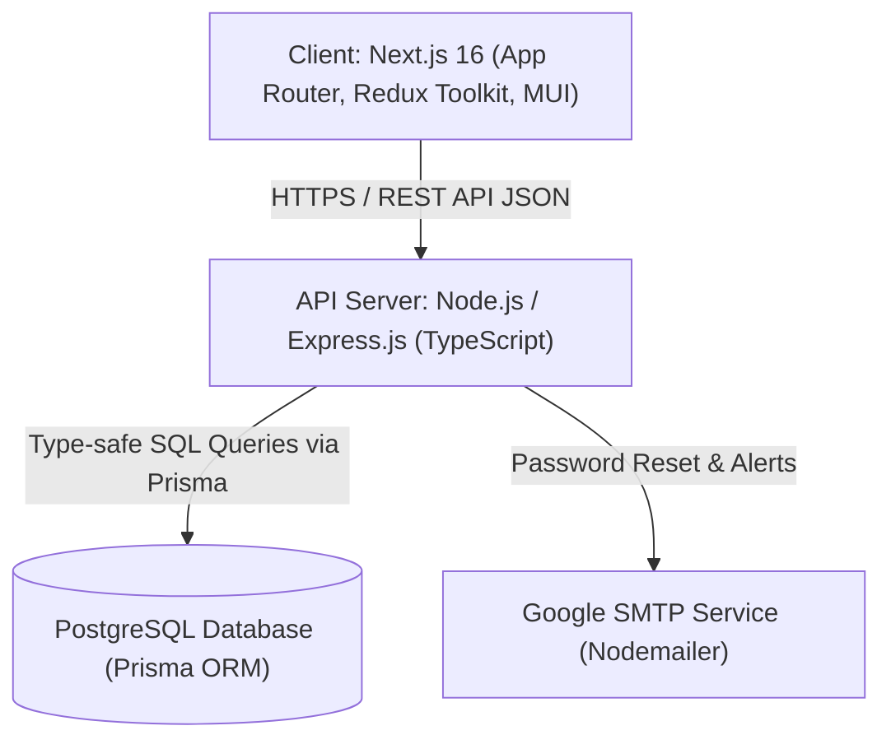
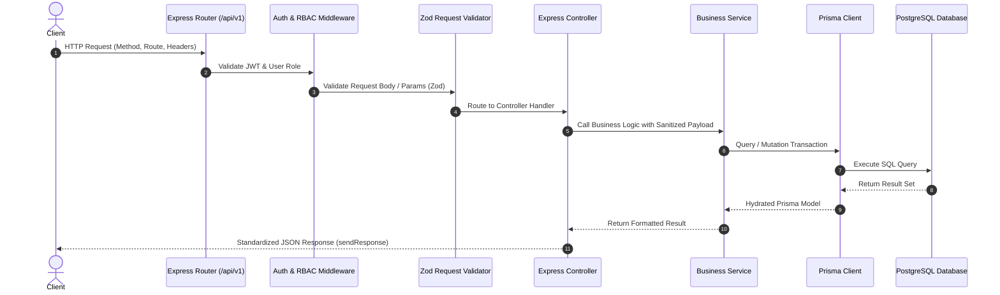
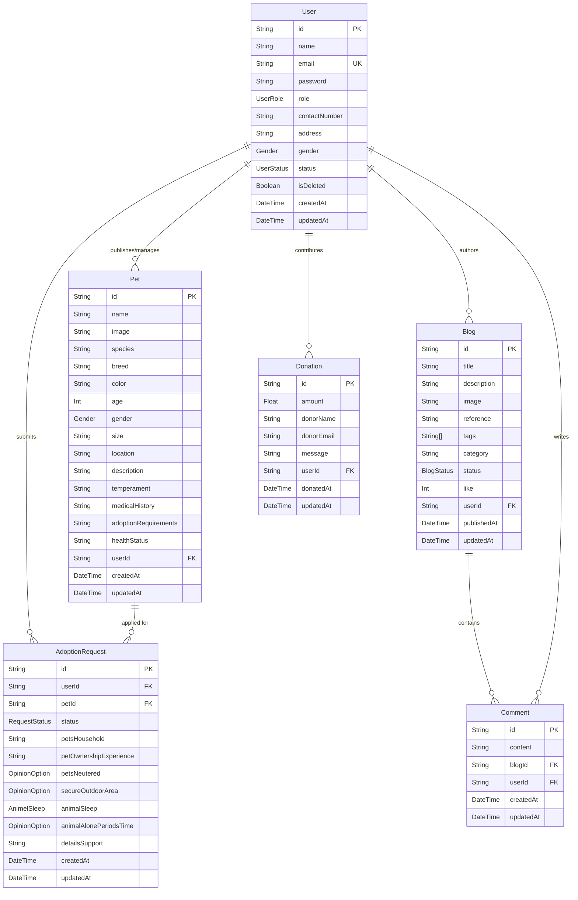
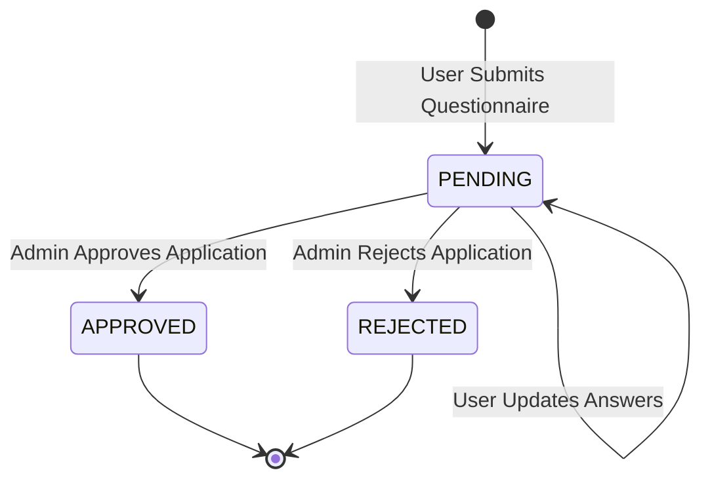

# Petfinder - System Architecture & Engineering Blueprint

This document specifies the software architecture, data modeling, component boundaries, asynchronous flows, and design patterns governing the **Petfinder** pet adoption and rescue management system.

---

## 1. High-Level System Architecture

Petfinder is architected as a decoupled, multi-tier system comprising a **Next.js 16** frontend (App Router, Turbopack, Material UI, Redux Toolkit), an **Express.js TypeScript** REST API server, **Prisma ORM**, and a **PostgreSQL** relational database.

---

## 2. Layered Application Architecture (Server)

The backend follows a modular, layered design pattern enforcing strict separation of concerns across each incoming request:

### Layer Responsibilities

1. **Routing Layer (`src/app/routes/`)**: Registers modular route groups under the `/api/v1` namespace.
2. **Middleware Layer (`src/app/middlewares/`)**:
   - `auth.ts`: Decodes and validates JWT bearer tokens, checks token validity, and enforces user role constraints.
   - `validateRequest.ts`: Intercepts and parses incoming request payloads against Zod validation schemas.
   - `globalErrorHandler.ts`: Catches exceptions, maps Prisma and Zod errors to consistent HTTP responses, and handles environment-specific error stack formatting.
3. **Controller Layer (`*.controller.ts`)**:
   - Extracts and unwraps query parameters, route parameters, request bodies, and authenticated user credentials.
   - Delegates business execution to the corresponding service module.
   - Envelopes output using `sendResponse()`.
4. **Service Layer (`*.service.ts`)**:
   - Encapsulates business logic, data calculations, authorization checks, and third-party integrations (e.g. Nodemailer).
   - Coordinates database transactions (`prisma.$transaction`) to guarantee atomicity.
5. **Data Access Layer (`prisma/schema.prisma` & `src/app/shared/prisma.ts`)**:
   - Provides a singleton Prisma client instance across the application lifecycle.
   - Exposes strongly typed entity models, relations, cascades, and enum definitions.

---

## 3. Database Entity Relationship Model

The relational PostgreSQL schema links users, pet listings, adoption requests, blogs, comments, and donations:

---

## 4. Key Architectural Subsystems

### A. Adoption Request Lifecycle & State Machine

The adoption workflow enforces strict validation and state transitions:

1. **Submission**: Authenticated users submit a comprehensive application assessing living conditions, household pets, outdoor security, and daily solitude periods.
2. **Review & Triage**: Shelter staff (`ADMIN` / `SUPER_ADMIN`) review submissions through `/api/v1/adoption-requests`.
3. **Status Update**: Applications transition from `PENDING` to either `APPROVED` or `REJECTED` via a dedicated patch endpoint (`PATCH /api/v1/adoption-requests/:requestId/status`).

---

### B. Role-Based Access Control (RBAC) Matrix

Petfinder maintains three distinct hierarchical roles:

| Module / Action | `USER` | `ADMIN` | `SUPER_ADMIN` |
| :--- | :---: | :---: | :---: |
| Browse & Search Pets | ✅ | ✅ | ✅ |
| Submit Adoption Application | ✅ | ❌ | ❌ |
| Create / Edit / Delete Pet Listing | ❌ | ✅ | ✅ |
| Review / Approve Adoption Requests | ❌ | ✅ | ✅ |
| Publish / Manage Blogs | ❌ | ✅ | ✅ |
| Comment on Blogs | ✅ | ✅ | ✅ |
| Make Donations | ✅ | ✅ | ✅ |
| View Platform Analytics (`/meta`) | Personal | Shelter-wide | Full Platform |
| Promote / Demote Roles | ❌ | ✅ | ✅ |
| Soft-Delete User Accounts | ❌ | ❌ | ✅ |

---

### C. Authentication & Session Security Flow

1. **Access Token Generation**: Upon successful authentication via `POST /api/v1/auth/login`, an HMAC SHA-256 JWT access token is signed with `JWT_SECRET` (default lifespan: 7 days) and returned in the JSON payload.
2. **Refresh Token Rotation**: A separate long-lived refresh token signed with `REFRESH_TOKEN_SECRET` is placed in an `httpOnly`, `sameSite`, and secure cookie (`refreshToken`).
3. **Password Recovery Workflow**:
   - User requests reset via `POST /api/v1/auth/forgot-password`.
   - The server verifies user status, generates a short-lived token (15m expiry), constructs a secure link, and dispatches an HTML email via Google SMTP (Nodemailer).
   - User verifies token and submits new credentials via `POST /api/v1/auth/reset-password`.

---

### D. Analytics & Meta Aggregator (`/meta`)

The `/api/v1/meta` route provides role-aware business intelligence:
- **`SUPER_ADMIN` & `ADMIN`**: Computes total registered users, active pet listings, adoption conversion ratios (pending vs. approved), and gross donation volume.
- **`USER`**: Delivers a personalized summary of submitted adoption applications, active requests, and contribution history.
